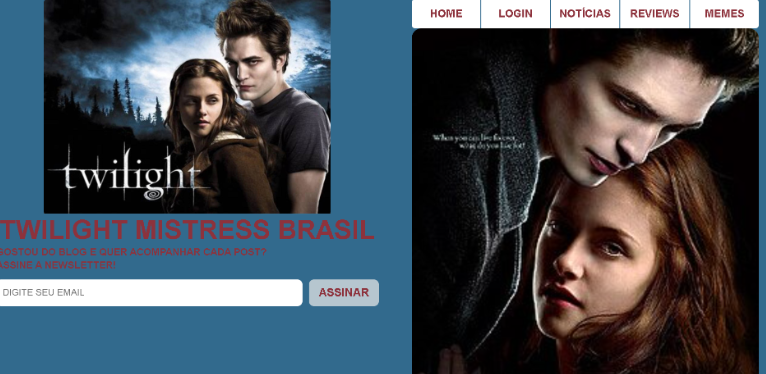
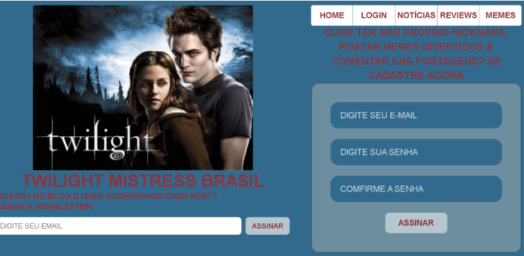
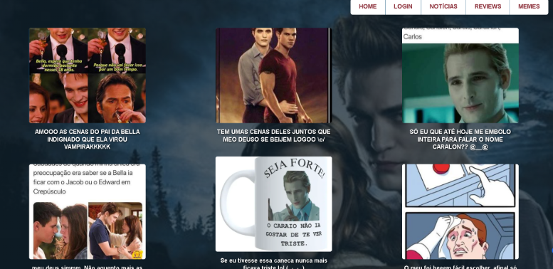
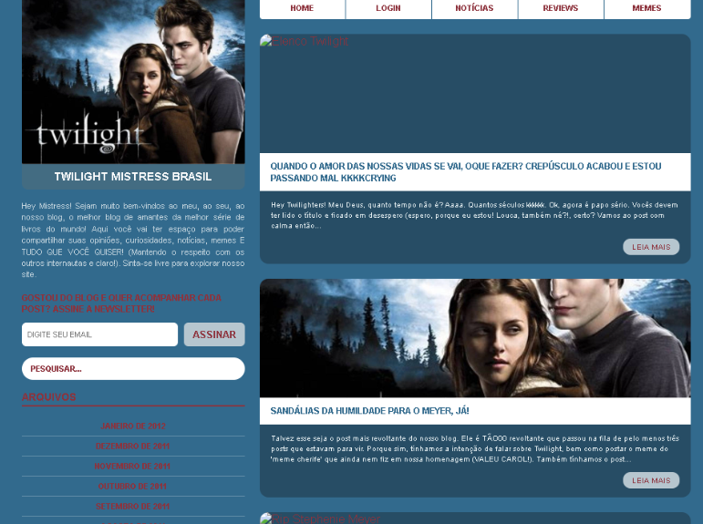

- Antonio Augusto Rocha Santos, Samuel Silva Cardoso

- Josué Rodrigo Figueiredo Evangelista

- Informática para a Internet - Versionamento e Colaboração

- 12 de Novembro de 2026

- Escola SESI Anísio Teixeira - 2o Ano D

## TWILIGHT MISTRESS BRAZIL

O projeto apresentado a seguir surgiu de uma indignação simples, a falta de espaço para
que garotas pré-adolescentes ou adolescentes fãs da saga cine e literária CREPÚSCULO
tivessem para si espaços próprios para a partilha de interesses e indagações críticas sobre a saga
em um ambiente seguro no espaço virtual. Percebemos que no ambiente da internet existiam
poucos ou nenhum tipo de espaço para que essas meninas pudessem se expressar livremente e
completamente livres de preconceitos, por esse motivo surgiu o TWILIGHT MISTRESS
BRASIL, um site completamente focado em dar a elas esse tipo de espaço seguro e saudável
para a interação e troca de interesses em comum.

## FUNCIONALIDADES E TECNOLOGIAS UTILIZADAS

As funcionalidades implementadas tiveram como principal objetivo o conforto e
segurança das usuárias. Entre as principais estão:
Possibilidade de Login
Essa funcionalidade permite aos usuários se cadastrarem e logarem através de e-mail e senha na
sua conta, o que permite retomar o acesso às suas postagens, interações e comentários anteriores.

***Aba HOME***

Essa funcionalidade permite aos usuários ao adentrarem o site terem acesso às últimas postagens
realizadas no blog. Isso permite que sempre ocorra uma renovação no conteúdo acessado.

***Newsletter***
A funcionalidade de Newsletter funciona como uma extensão do site para além do html, ela
permite aos usuários receberem informações periódicas, sejam elas notícias da comunidade,
curiosidades da saga e até os últimos burburinhos da vida dos atores!

***Aba ARQUIVADOS***
Essa funcionalidade permite aos usuários acessarem postagens e textos mais antigos do blog.
Isso além de eternizar as memórias de grandes momentos momentos da comunidade também
gera uma biblioteca de conhecimento para antigos e novos internautas lerem e relerem debates
previamente discutidos.

***Aba MEMES***
Essa aba tem como principal intuito o lazer e entretenimento das telespectadores. Através dessa
função, elas vão poder compartilhar memes(termo utilizado pelos internautas para descrever
imagens e vídeos engraçados) da saga e piadas internas da comunidade sempre acompanhados de
comentários e observações perspicazes, alimentando assim o espírito de união dentro do site.

***Barra de Navegação***
Essa funcionalidade se alinha com as heurísticas de Heulen ao permitir os usuários navegarem
pelas abas apresentadas de maneira simples e ágil, entretanto, apesar de já aparecer visualmente e
ser clicável a barra ainda está em desenvolvimento para conseguir transitar entre as páginas.

Para que esse projeto fosse então realizado com total êxito, foram utilizadas as respectivas
tecnologias:
- HTML5;
- CSS3;
- JavaScript;
- Visual Studio Code.

Além disso, é impossível não discorrer sobre ou mencionar o uso das pastas e do Google Docs
para o armazenamento do código e salvamento de arquivos que nos ajudaram a nos guiar durante
todo o processo e a manter o código principal do blog completamente intacto e livre de possíveis
inconsistências do sistema

## ESTRUTURA E EXECUÇÃO

O arquivo compactado que contém o site possui dois tipos de arquivos, os .html que
possuem o código das páginas previamente apresentadas e as .png que carregam as imagens
dentro do site, ambos são essenciais para o funcionamento adequado do site.
Para que fosse possível acompanhar a execução do código em tempo real, foi utilizado
um atalho dentro do visual code (nossa principal plataforma de código) denominada Live Server.
O Live Server tinha como principal funcionalidade disponibilizar um servidor para acompanhar
de maneira técnica e visual as últimas alterações dos site, tudo em tempo real, dando esse
privilégio a quem tivesse o código e a instalação em seu visual code.

## DEMONSTRAÇÃO

A imagem anexada apresenta a página inicial do site, onde se é possível ver a última
notícia adicionada e realizar a assinatura da newsletter.

Na página de Login, anexada acima, é onde é possível realizar o Login para cadastrar seu
e-mail e salvar suas atividades dentro do blog.

A página de memes é onde é possível a interação real entre as garotas, sendo
completamente dedicada ao compartilhamento de memes e aba para o diálogo, troca de ideias e
diversão entre elas.

Na página de notícias é onde é dada às leitoras a chance de ler as matérias mais antigas
do blog, proporcionando a elas um acervo das notícias gigantescas do site.

## FUTURO E POSSÍVEIS MELHORIAS

Como propostas de melhorias a serem adicionadas futuramente recomenda-se:

- Implementar de maneira adequada a navegação entre páginas:

Com um maior domínio da técnica de prototipagem e código, espera-se ser possível a
implementação da interação entre as páginas e de navegação adequada, dando aos usuários uma
experiência mais agradável e intuitiva.

- Desenvolvimento de mais abas de interação entre usuários:

Para que os usuários possam ter interações além das postagens, pretende-se desenvolver
abas com outros tipos de formas de conversa, assim como a aba de memes.

- Implementação do chat para interação direta:

Uma das principais ideias para futuras melhorias seria o chat na página de memes, permitindo
com que as meninas interagem diretamente entre si, possibilitando a troca de mensagens e
compartilhamento completamente livres de ideias.